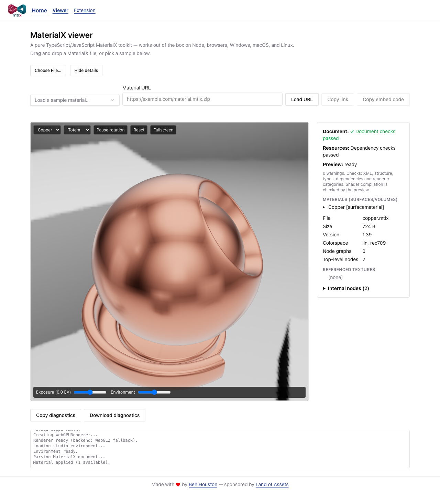

<p align="center">
  <a href="https://mtlx.ben3d.ca" target="_blank" rel="noopener noreferrer">
    
  </a>
</p>
<br/>
<p align="center">
  <a href="https://npmjs.com/package/mtlx-core"></a>
  <a href="https://www.npmtrends.com/mtlx-core"></a>
  <a href="https://codecov.io/gh/bhouston/mtlx"></a>
  <a href="https://discord.gg/wzQWaBBxup"></a>
  <a href="https://mtlx.ben3d.ca/docs/"></a>
</p>
<br/>

# mtlx

> View, edit, validate, and ship MaterialX materials on the web.

- 🎨 Interactive 3D Material Preview
- 🧩 Drop-In Web Component
- 🕸️ Node Graph Editing
- ✅ Validation and Inspection
- 📦 Portable `.mtlx.zip` Packages
- 💻 CLI and VS Code Extension

mtlx is a set of TypeScript and JavaScript tools for working with [MaterialX](https://materialx.org) materials. Work with loose `.mtlx` files or portable `.mtlx.zip` archives in the browser, terminal, or VS Code.

[Read the Docs to Learn More](https://mtlx.ben3d.ca/docs/).

## Packages

| Package                                            | Version (click for changelogs)                                                                                                                                    |
| -------------------------------------------------- | :---------------------------------------------------------------------------------------------------------------------------------------------------------------- |
| [mtlx-core](packages/core)                         | [](https://github.com/bhouston/mtlx/releases)                                           |
| [mtlx-viewer](packages/viewer)                     | [](https://github.com/bhouston/mtlx/releases)                                       |
| [mtlx-cli](packages/cli)                           | [](https://github.com/bhouston/mtlx/releases)                                             |
| [mtlx-sdk](packages/sdk)                           | [](https://github.com/bhouston/mtlx/releases)                                             |
| [mtlx-vscode-extension](packages/vscode-extension) | [](https://github.com/bhouston/mtlx/releases) |

[Try the viewer](https://mtlx.ben3d.ca/viewer/) · [Open the editor](https://mtlx.ben3d.ca/editor/) · [Get started](https://mtlx.ben3d.ca/docs/quick-start/)



## Embed a material

Add `<material-viewer>` to any HTML page. No React or build step is required.

```html
<script type="module" src="https://cdn.jsdelivr.net/npm/mtlx-viewer/dist/material-viewer.js"></script>
<material-viewer
  src="https://mtlx.ben3d.ca/materials/copper/copper.mtlx"
  alt="Copper material under neutral studio lighting"
  settings-panel="closed"
  style="display:block;width:100%;height:440px"
></material-viewer>
```

[Element guide and live demo](https://mtlx.ben3d.ca/docs/material-viewer/)

## Use the CLI

```sh
npm install --global mtlx-cli
mtlx check material.mtlx
mtlx view material.mtlx
mtlx transform material.mtlx -o material.mtlx.zip --profile web
```

## Choose a library

| Package                                                                                                     | Use it for                                                             | Documentation                                         |
| ----------------------------------------------------------------------------------------------------------- | ---------------------------------------------------------------------- | ----------------------------------------------------- |
| [mtlx-core](https://www.npmjs.com/package/mtlx-core)                                                        | Parsing, validation, packaging, transforms, and headless graph editing | [Core guide](https://mtlx.ben3d.ca/docs/core/)        |
| [mtlx-viewer](https://www.npmjs.com/package/mtlx-viewer)                                                    | Web component, React wrapper, and Three.js preview APIs                | [Viewer guide](https://mtlx.ben3d.ca/docs/viewer/)    |
| [mtlx-cli](https://www.npmjs.com/package/mtlx-cli)                                                          | Local workflows and MTLX.ai commands                                   | [CLI guide](https://mtlx.ben3d.ca/docs/cli/)          |
| [mtlx-sdk](https://www.npmjs.com/package/mtlx-sdk)                                                          | Typed MTLX.ai service client                                           | [SDK guide](https://mtlx.ben3d.ca/docs/sdk/)          |
| [mtlx-editor](packages/editor)                                                                              | Reusable React node editor (source workspace package)                  | [Editor guide](https://mtlx.ben3d.ca/docs/editor/)    |
| [VS Code extension](https://marketplace.visualstudio.com/items?itemName=benhouston3d.mtlx-vscode-extension) | Previews, node graphs, and packaging inside your editor                | [Extension guide](https://mtlx.ben3d.ca/docs/vscode/) |

Node tools require Node.js 22+. Browser rendering needs GPU-backed WebGPU or WebGL2. Validation covers selected document rules; preview support follows Three.js's MaterialX loader.

## Releases

See [RELEASING.md](RELEASING.md) for how releases are published and [GitHub Releases](https://github.com/bhouston/mtlx/releases) for changes.

## Contribution

See [Contributing Guide](CONTRIBUTING.md).

## License

MIT

## Author

[Ben Houston](https://ben3d.ca), Sponsored by [Land of Assets](https://landofassets.com).
