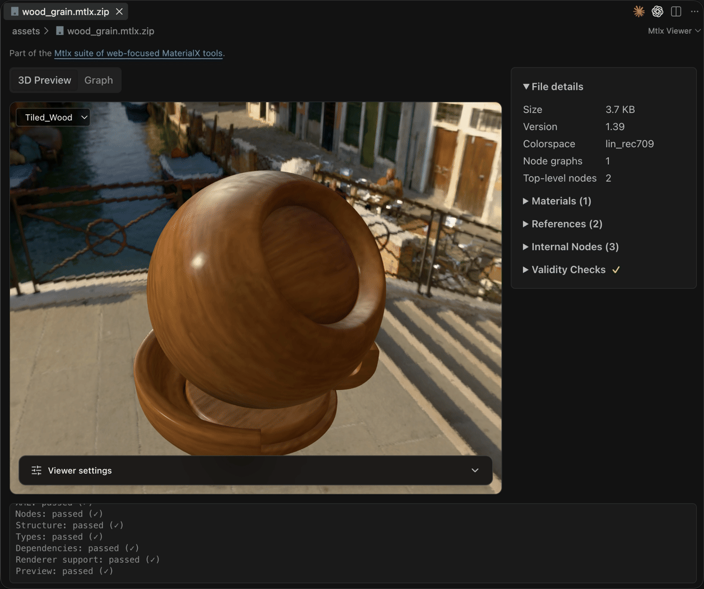

# Mtlx Viewer for MaterialX

Preview, inspect, and package MaterialX without leaving VS Code. Open `.mtlx` or `.mtlx.zip` files for an interactive 3D preview, node graph, and validation report. Saving a material or its textures refreshes the preview.

1. Install from the [VS Code Marketplace](https://marketplace.visualstudio.com/items?itemName=benhouston3d.mtlx-vscode-extension) or [Open VSX](https://open-vsx.org/extension/benhouston3d/mtlx-vscode-extension).
2. Open a `.mtlx` or `.mtlx.zip` file.
3. Drag to orbit, scroll to zoom, or switch to the **Graph** tab to inspect nodes.

Use **Reopen Editor With → Text Editor** to edit XML. Right-click materials in Explorer to pack or unpack `.mtlx.zip` archives.

Requires desktop VS Code 1.85+ with GPU acceleration. Preview support follows Three.js's MaterialX loader.

See the [extension guide](https://mtlx.ben3d.ca/docs/vscode/) for settings, custom lighting and models, conversion workflows, and troubleshooting.

## License

MIT

## Author

[Ben Houston](https://ben3d.ca), Sponsored by [Land of Assets](https://landofassets.com).
